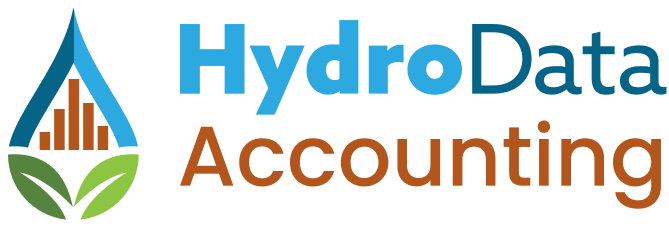

  <picture>
    <source media="(prefers-color-scheme: dark)" srcset=".github/assets/hda-horizontal-white.svg">
    
  </picture>

  <strong>Stream depletion lagging for Colorado augmentation plans.</strong> 
  A desktop app from Longitude 103, part of the <a href="https://hydrodata.app">HydroData</a> suite.

  
  
  

  <a href="https://github.com/Longitude103/hydrodata-accounting-releases/releases/latest"><strong>Download the latest version</strong></a>

---

## What it does

HydroData Accounting brings your AWAS work onto a modern desktop app, with the same lagging methods and the same numbers.

- **Import AWAS `.dsi` files.** The app checks every site as it imports, and compares the results with the matching `.dso` so you can see they agree.
- **Build and edit plans.** Start from an import or a blank plan, then add wells and recharge sites, combine a well's reaches, and tag sites.
- **See the lag.** Each site shows its pumping or recharge next to the depletion or accretion it causes at the stream, month by month.
- **Export for your filings.** Send results to Excel or CSV by calendar year, water year or SWSP year, with totals by tag.

## Download

| Platform | Installer |
| --- | --- |
| **Windows 10 and 11** | The `.exe` installer (or the `.msi` for managed installs) |
| **macOS** (Apple silicon and Intel) | The `.dmg` |

Get both from the [latest release](https://github.com/Longitude103/hydrodata-accounting-releases/releases/latest). Once it's installed, the app checks for new versions when it starts and offers to restart into them.

## Built to be trusted

- **Signed installers.** Windows installers are signed by Adaptive Resources, Inc., Longitude 103's parent company, through Microsoft's Trusted Signing. Mac apps are signed with an Apple Developer ID and notarized by Apple, so Windows and macOS can confirm the app comes from us and hasn't been changed.
- **Verified updates.** Every update is signed, and the app checks that signature before it installs anything.
- **Your files stay yours.** Plans are saved on your computer. The app never changes your AWAS files: imports and exports always write new files.

## Part of HydroData

HydroData Accounting is part of [HydroData](https://hydrodata.app), Longitude 103's suite of water management tools. Use [hydrodata.app](https://hydrodata.app) to store and share your water data, such as meter readings, usage and well records, alongside your plan accounting.

---

  © Longitude 103 · Adaptive Resources, Inc. · This repository holds releases only. The source code is not published here.

